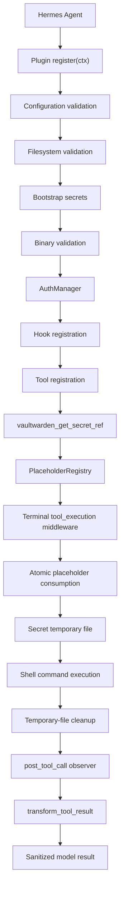

# Hermes Vaultwarden Plugin v0.7.9 – Independent Security Audit


The review treats the implementation as a fresh audit. Documentation, changelog claims and existing tests are not accepted as proof that a security control works.

Initial architectural assessment: The implementation has a substantial security design, including single-use placeholders, isolated subprocess environments, filesystem validation, execution-scoped secret retention and a dedicated result-transformation hook.

Two particularly important controls require separate verification:
- **Atomic placeholder resolution**: The registry implements a mutex-protected `consume_and_resolve()` operation. The middleware is designed to resolve each unique placeholder once and reuse its generated temporary-file reference.
- **Authoritative result redaction**: Redaction is implemented in `transform_tool_result`, while `post_tool_call` is intended to be an observer and cleanup hook. The transformer returns sanitized results for the supported result types.

These are positive implementation observations, not yet a certification of the complete security boundary.

## 1. Executive summary

**HIGH** – overall risk

The plugin demonstrates good security engineering practices, but the static review identified a significant weakness in the execution-scoped redaction lifecycle.

| Area | Assessment |
| --- | --- |
| Plugin architecture | Good |
| Placeholder generation and consumption | Correct |
| Atomic multi-occurrence resolution | Verified |
| Authoritative result redaction | Partial – concurrency defect |
| Filesystem hardening | Good, with limitations |
| Subprocess isolation | Partial |
| Session-key protection | Good |
| HTTPS enforcement | Implemented, with validation gap |
| SSH integration | Partial |
| Error handling | Generally good |
| Dependency management | Low risk |
| Test coverage | Extensive, execution unverified |

**Main concern**: Concurrent tool executions sharing a Hermes `task_id` can cause the redaction handoff to associate the wrong secret set with a tool result. This can expose a vault secret in the model context.

This is particularly important because secret confidentiality is the primary security objective of the plugin.

The archive consistently identifies itself as v0.7.9 in both `pyproject.toml` and `plugin.yaml`. Some version references in the supplied audit prompt (including v0.6.9 manifest and log examples) are outdated and were not used as evidence about the actual implementation.

## 2. Findings table

Three findings warrant remediation.

| ID | Severity | Category | Location |
| --- | --- | --- | --- |
| HVA-01 | HIGH | Security | `hooks.py` – execution scope and deferred handoff |
| HVA-02 | MEDIUM | Compatibility / Reliability | `config.py` – URL validation and sanitization |
| HVA-03 | MEDIUM | Security / Third-Party Integration | `tools.py`, `bw_cli.py` – subprocess environment |

### HVA-01 – Incorrect secret correlation during concurrent executions

**HIGH**

**Location:**
- `plugins/vaultwarden/hooks.py`
- `ExecutionSecretScope.close()`
- `_stash_deferred_injected()`
- `peek_scope_injected_secrets()`
- `make_result_redactor()`

**Description**

The plugin uses `task_id` as the primary correlation key for secret redaction.

However, Hermes provides a separate `tool_call_id` for identifying individual tool calls.

The implementation stores deferred execution secrets in:

```python
_DEFERRED_INJECTED: dict[
    str, tuple[float, frozenset[str]]
] = {}
```

The key is the execution ID, which is currently populated using `task_id`.

When a scope closes:

```python
_DEFERRED_INJECTED[key] = (now, values)
```

This replaces any previous entry with the same key.

There is a corresponding problem in `peek_scope_injected_secrets()`:

```python
for scope in reversed(scopes):
    if getattr(scope, "_task_id", "") == exec_id:
        return list(scope.injected_values())
```

Only the most recently opened matching scope is selected.

**Why this matters**

Hermes distinguishes `task_id`, `tool_call_id` and `turn_id`. The tool dispatcher passes these identifiers independently to the middleware and result transformer.

Consequently, multiple tool executions belonging to the same task can share a `task_id`.

Consider this scenario:
1. Execution A injects secret A.
2. Execution B injects secret B.
3. Both executions share the same task ID.
4. Their middleware scopes close.
5. The deferred entry for one execution overwrites the other.
6. The result transformer retrieves the wrong secret snapshot.

If execution A produces output containing secret A but receives only secret B's redaction snapshot, secret A can survive into the model context.

The implementation therefore does not fully satisfy the overlapping-execution confidentiality requirement.

**Recommendation**

Use a unique per-tool-execution identifier, preferably `tool_call_id`, as the primary correlation key.

The identifier must be propagated consistently through:
- Middleware scope creation.
- Active-scope registration.
- Deferred secret storage.
- Result transformation.
- Cleanup.

Do not use a single-value dictionary entry keyed only by `task_id` for multiple concurrent executions.

Also add regression tests covering:
- Two overlapping calls sharing one task ID.
- Different secrets in each call.
- Both possible completion orders.
- Concurrent transformer invocation.
- Repeated result transformation.
- Cleanup after both executions finish.

This is the highest-priority remediation.

### HVA-02 – Invalid URL ports are not rejected during configuration validation

**MEDIUM**

**Location:**
- `plugins/vaultwarden/config.py`
- `_validate_server_url_scheme()`
- `_sanitize_url_for_logging()`
- `plugins/vaultwarden/__init__.py`, final activation logging

**Description**

The URL validation checks the scheme, user information, query parameters and fragments.
However, it does not validate the port.

The sanitization function subsequently accesses:

```python
parsed.port
```

Python's URL parser raises `ValueError` for invalid or out-of-range ports.
For example:

```text
https://vault.example.com:99999
https://vault.example.com:abc
```

These values can pass the existing scheme validation but fail during URL sanitization.

The final activation log invokes:

```python
_sanitize_url_for_logging(config.server_url)
```

This occurs after tool and hook registration.

**Impact**

A malformed configuration can cause plugin initialization to fail unexpectedly, potentially after registration has already modified the host's plugin context.

The result is inconsistent activation behavior and potentially partially registered plugin components. Whether the host rolls those registrations back requires runtime verification.

**Recommendation**

Validate the URL's hostname and port explicitly during `PluginConfig.validate()`.

For example:

```python
try:
    parsed = urlparse(self.server_url)
    hostname = parsed.hostname
    port = parsed.port
except ValueError:
    raise errors.ConfigError(
        "Invalid Vaultwarden server URL."
    )
```

Also reject missing hostnames and invalid network authorities.
URL sanitization should independently handle malformed URLs without raising an exception.

### HVA-03 – SSH subprocess executable lookup remains PATH-dependent

**MEDIUM**

**Location:**
- `plugins/vaultwarden/tools.py:135-151`
- `plugins/vaultwarden/bw_cli.py:352-358`
- SSH subprocess calls throughout `tools.py`

**Description**

The plugin correctly uses an explicit environment allowlist.
However, it constructs the subprocess environment using:

```python
env = {
    "PATH": os.environ.get(
        "PATH",
        "/usr/local/bin:/usr/bin:/bin"
    ),
    "HOME": os.environ.get(
        "HOME",
        str(Path.home())
    ),
    "LC_ALL": "C",
}
```

The same approach is used by `BwCli.base_env()`.
This means that although the complete parent environment is not inherited, its `PATH` value is inherited.

The SSH executables are invoked by name rather than by validated absolute path:

```python
subprocess.run(
    ["ssh-add", key_path],
    env=env,
    ...
)
```

The same applies to `ssh-keygen` and `ssh-agent`.

**Impact**

If the Hermes process starts with an attacker-controlled or otherwise untrusted PATH, a malicious executable can be selected instead of the intended OpenSSH binary.
This is particularly relevant to `ssh-add`, because its environment contains:

```text
VW_SSH_PASS
```

The malicious executable could read the passphrase and access the private-key temporary file.
This finding requires an attacker to influence the parent process's PATH; it is not an unconditional remote vulnerability.

**Recommendation**

Use explicitly configured absolute executable paths for:
- `ssh-add`
- `ssh-keygen`
- `ssh-agent`

Validate the binaries similarly to `bw_cli_path`.
Alternatively, construct a fixed trusted PATH from administrator-controlled directories, rather than copying the Hermes process's PATH.
The allowlist should remain, but allowlisting a variable name alone does not establish that its value is trustworthy.

## 3. Detailed architectural analysis

### 3.1 Plugin architecture and execution flow

The plugin has a reasonably clear separation of responsibilities.



The principal components are:

| Component | Responsibility |
| --- | --- |
| `__init__.py` | Plugin initialization and registration |
| `config.py` | Configuration and HTTPS validation |
| `auth.py` | Authentication, session management and recovery |
| `bw_cli.py` | Bitwarden CLI subprocess integration |
| `tools.py` | Vault and SSH tool implementations |
| `placeholders.py` | Single-use secret references |
| `hooks.py` | Injection, execution scopes and redaction |
| `security.py` | RedactingFilter and secret lifecycle |
| `secure_fs.py` | Filesystem validation |
| `compat.py` | Hermes API compatibility |

### 3.2 Hermes lifecycle integration

An important distinction emerged from checking the actual Hermes implementation.

The supplied audit prompt describes this order:

```text
tool_execution middleware
    ↓
transform_tool_result
    ↓
post_tool_call
```

However, the current Hermes dispatcher implements:

```text
tool_execution middleware
    ↓
post_tool_call
    ↓
transform_tool_result
    ↓
conversation context
```

The official dispatcher confirms that `post_tool_call` is emitted before `_apply_transform_tool_result_hook()`.

This matters because the middleware's execution scope has already closed when the result transformer runs.
The plugin anticipates this with its deferred handoff mechanism. That is a sensible architectural solution, but its task-level correlation weakness is the HVA-01 finding.

The observer hook itself does not perform confidentiality redaction. This separation is correct.

**Result**: The authoritative redaction mechanism is correctly located, but its execution correlation is not sufficiently isolated.

### 3.3 Placeholder resolution

**Atomic resolution verified**

The implementation in `placeholders.py` is sound for the specified single-command, multi-occurrence scenario.

The critical operation is:

```python
def consume_and_resolve(self, token):
    with self._lock:
        entry = self._entries.get(token)

        if entry is None:
            return None

        if self._expired_locked(entry):
            del self._entries[token]
            return None

        if entry.used:
            del self._entries[token]
            return None

        entry.used = True
        return entry
```

The middleware then extracts unique token suffixes:

```python
unique_suffixes = list(dict.fromkeys(
    m.group(1)
    for m in _VW_SECRET_CMD_RE.finditer(command)
))
```

It resolves each unique token once and replaces all occurrences with the same generated shell reference.
This prevents the sequential-consumption problem.
Cross-call reuse is also rejected.

**Conclusion**: HVA-01 is unrelated to the atomic registry operation. The registry's single-use semantics are correctly implemented; the defect is in subsequent result correlation.

### 3.4 Secret data flow

The plugin implements an intentional asymmetry between reading and writing secrets.

**READ path**

```text
Vault
  ↓
AuthManager
  ↓
PlaceholderRegistry
  ↓
Opaque token returned to agent
  ↓
Terminal middleware
  ↓
chmod 600 temporary file
  ↓
Shell reads secret
  ↓
Result redaction
```

The secret does not need to be returned in the tool response.

**WRITE path**

```text
Agent
  ↓
vaultwarden_store / update
  ↓
password_file OR generate=true
  ↓
Vault
```

Raw direct input is permitted as an acknowledged exception.
The `_resolve_secret_input()` function correctly emits a log warning and returns an advisory warning in the tool response.
Conflicting direct and file sources are rejected.
The `*_env` input channel is explicitly rejected.
This is consistent with the stated security design.

### 3.5 Third-party integration

The plugin invokes Bitwarden CLI through argument arrays rather than shell command construction.
For example:

```python
cmd = [self.bw_path, *args]

proc = subprocess.run(
    cmd,
    env=full_env,
    capture_output=True,
    text=True,
    timeout=timeout or self.timeout,
    stdin=subprocess.DEVNULL,
)
```

Positive observations:
- Absolute `bw` executable path.
- Binary ownership and permission validation.
- Symlink rejection.
- Version enforcement.
- Explicit subprocess environment.
- Session key injection through a centralized mechanism.
- Timeout handling.
- No automatic retries for selected non-idempotent operations.
- JSON parsing and structured error handling.

The session key is not intentionally persisted to disk or `os.environ`.

The integration with OpenSSH is also generally well structured, particularly its use of `SSH_ASKPASS`, `start_new_session=True` and temporary private-key files.

The principal identified weakness is executable lookup through inherited PATH.

## 4. Security controls verification

The following table evaluates the actual implementation in the uploaded archive, not the claims in its documentation.

| Security control | Assessment | Evidence |
| --- | --- | --- |
| READ-path placeholder injection | Correct | `hooks.py`, `tools.py` |
| File-based secret injection | Correct | `secure_fs.py`, `hooks.py` |
| WRITE-path secret channels | Correct | `tools.py` |
| Raw-secret dual-channel warning | Correct | `tools.py` |
| Conflicting secret sources | Correct | `_resolve_secret_input()` |
| Atomic placeholder resolution | Correct | `placeholders.py`, `hooks.py` |
| Cross-call placeholder reuse protection | Correct | `consume_and_resolve()` |
| Authoritative result redaction | Partial | `hooks.py`, HVA-01 |
| Observer-only post_tool_call | Correct | `make_post_cleanup_hook()` |
| Scoped redaction reference counting | Partial | `security.py`, `hooks.py` |
| Strict secrets directory validation | Correct | `secure_fs.py` |
| Appdata directory hardening | Correct | `secure_fs.py`, `bw_cli.py` |
| Bootstrap secrets file validation | Correct | `secure_fs.py`, `secrets.py` |
| Observable cleanup failures | Correct | `hooks.py`, `tools.py` |
| Stale-file TTL alignment | Correct | `__init__.py`, `hooks.py` |
| HTTPS enforcement | Partial | `config.py`, HVA-02 |
| Binary path pinning for bw | Correct | `bw_cli.py` |
| SSH executable path pinning | Missing | HVA-03 |
| Lifecycle hook registration | Correct | `__init__.py`, `compat.py` |
| Session-key memory-only design | Correct | `auth.py`, `bw_cli.py` |
| Subprocess environment isolation | Partial | `bw_cli.py`, `tools.py` |
| Shell-safe injected paths | Correct | `security.py`, `hooks.py` |
| ContextVar cleanup | Correct | `hooks.py` |
| Status reporting predicate | Correct | `auth.py`, `tools.py` |
| Recovery-on-read | Correct | `auth.py`, `tools.py` |
| Deployment-agnostic operation | Unverified | Runtime testing required |

### Additional security observations

**Filesystem hardening**

The shared validator is a good design decision. It uses `os.lstat()` for directory and file validation and rejects insecure permissions instead of silently repairing them.

The secret input file implementation is particularly strong:

```python
fd = os.open(str(p), flags)
```

It then validates the opened descriptor using `os.fstat(fd)` and reads from that same descriptor.
This eliminates the usual path-validation/open TOCTOU window for `password_file` and `pass_file`.

One limitation remains: directory validation primarily checks the final directory component, not the complete ancestor chain. In particular, `XDG_RUNTIME_DIR` is accepted using `os.path.isdir()` and `os.access()`, both of which follow symlinks. This deserves additional hardening where runtime directory paths may be attacker-influenced.

**Temporary-file cleanup**

The relevant cleanup operations generally use `try/except OSError` and sanitized warnings.
The temporary secret files are created using `mkstemp()` and the code applies restrictive permissions.
Stale-file cleanup uses the configured placeholder TTL rather than an independent hardcoded lifetime.
These controls are implemented correctly in the reviewed paths.

**Scoped redaction**

The reference-counting implementation in `security.py` is well structured:
- `retain_secret()` increments references.
- `release_secret()` decrements them.
- Process-scoped secrets retain a minimum reference count.
- `demote_process_scoped()` handles session-key lifecycle transitions.
- `ExecutionSecretScope.close()` is idempotent.
- Overlapping holders of the same secret are protected from premature release.

The underlying reference counting is correct.
However, reference counting and result correlation are separate concerns. HVA-01 demonstrates that correctly retained secrets can still be associated with the wrong result.

**SSH passphrase handling**

The SSH implementation uses an askpass helper containing:

```sh
#!/bin/sh
echo "$VW_SSH_PASS"
```

The passphrase itself is not embedded in that script.
The helper uses `SSH_ASKPASS_REQUIRE=force`, and passphrase-handling subprocesses use `start_new_session=True`.
This is a reasonable implementation of the requested delivery mechanism. The executable-selection weakness is covered separately in HVA-03.

## 5. Third-party integration risk assessment

### Bitwarden CLI

**Generally acceptable integration design**

The CLI is treated as an external process, not as an extension of the plugin's own trusted execution environment.

The implementation provides:
- Explicit executable path.
- Minimum version enforcement.
- Timeouts.
- Isolated appdata.
- Session injection through a centralized choke point.
- Controlled retry behavior.
- Structured output handling.

One limitation is that the source archive does not contain the actual `bw` binary or evidence of integration testing against a live Vaultwarden instance.
Therefore, compatibility with every supported CLI version cannot be independently established.

### Vaultwarden server

**Reasonable transport security**

HTTPS is enforced by default.
The explicit `allow_insecure_http` override is restricted to HTTP and does not authorize arbitrary schemes.
The implementation also rejects user information, query parameters and fragments in the configured URL.
Certificate validation and actual TLS behavior depend on the external Bitwarden CLI and the deployment environment. These were not runtime-tested.

### OpenSSH

**Additional hardening required**

The passphrase handling and private-key temporary-file lifecycle are generally sound.
However, `ssh-add`, `ssh-keygen` and `ssh-agent` are resolved through PATH rather than pinned executable locations.
This leaves an avoidable executable substitution risk under an untrusted PATH configuration.

### Failure handling

| Failure scenario | Static assessment |
| --- | --- |
| Missing bw binary | Fail-closed |
| Invalid bw binary | Fail-closed |
| Unsupported bw version | Fail-closed |
| bw timeout | Handled |
| Malformed CLI output | Generally handled |
| Network failure | Retry/recovery mechanisms |
| Expired session | Recovery mechanisms |
| Missing secrets.yaml | Fail-closed |
| Insecure appdata | Fail-closed |
| Insecure runtime secrets directory | Fail-closed |
| Invalid placeholder | Unresolved, fail-safe |
| Temporary-file deletion failure | Observable warning |
| Missing transform hook | Fail-closed at initialization |
| Transformer execution failure | Host-level fail-open behavior |

An important distinction concerns the last row: the Hermes dispatcher currently catches exceptions from result transformers and returns the original result.
Consequently, the plugin's confidentiality guarantee depends on its transformer completing successfully. The implementation should continue to minimize the possibility of exceptions at this boundary.

## 6. Recommended remediation plan

### Immediate fixes
**Priority 1**

1. Fix HVA-01: Introduce per-tool-call correlation using `tool_call_id`. This is necessary before treating concurrent secret redaction as reliable.
2. Add concurrent redaction regression tests with two distinct secrets sharing one task ID.
3. Test both completion orders and transformer invocation orders.

### Short-term improvements
**Priority 2**

4. Fix HVA-02: Validate URL hostname and port before any plugin registration.
5. Make URL sanitization exception-safe.
6. Fix HVA-03: Pin OpenSSH executable paths or use a trusted fixed PATH.
7. Validate the complete directory ancestry of sensitive runtime paths.
8. Add tests for malformed URLs, including invalid and out-of-range ports.
9. Add tests for malicious PATH entries and executable substitution.

### Long-term improvements

10. Add integration tests against the actual Hermes 2026.10.x plugin API.
11. Test Docker, SSH, modal and local backend behavior independently.
12. Add a failure-injection test for transformer exceptions and malformed result objects.
13. Test concurrent execution across different sessions and process roles.
14. Establish automated dependency and supply-chain checks for development and build dependencies.
15. Document the actual lifecycle order used by Hermes rather than relying on an assumed hook sequence.

## 7. Missing information and audit limitations

The following information is necessary to elevate this static audit to a fully verified deployment audit.

| Required information | Current status |
| --- | --- |
| Exact Hermes Agent 2026.10.x patch version | Not supplied |
| Actual bw binary and version | Not supplied |
| OpenSSH version | Not supplied |
| Live Vaultwarden server | Not available |
| Deployment backend configuration | Not supplied |
| Runtime permissions and ownership | Not available |
| Real concurrent execution traces | Not available |
| Runtime integration test results | Not available |

**Testing limitation**: I inspected the uploaded source archive and performed syntax-only parsing of all production Python modules. No plugin code or test suite was executed because the archive contains untrusted executable code and no explicit authorization to execute it was supplied.

The archive contains 40 Python test files and approximately 777 test functions. Their presence is encouraging, but their passing status is unverified.

## Final conclusion

The v0.7.9 implementation is substantially more mature than a typical password-manager integration plugin. Its placeholder architecture, filesystem protections, session handling and secret lifecycle management demonstrate careful engineering.

However, I would not classify the current implementation as ACCEPTABLE for production use where preventing secret exposure to the LLM is a strict requirement.

The most important issue is HVA-01. It directly affects the confidentiality boundary and should be fixed before relying on concurrent execution.

My recommended order is:
1. Fix per-tool-call secret correlation.
2. Add concurrency regression tests.
3. Fix URL port validation.
4. Pin SSH executable paths.
5. Perform runtime integration testing against the exact Hermes 2026.10.x deployment.

**Audit disposition: Remediation required before production security approval.**

The atomic placeholder resolution itself is verified correct. The authoritative result-redaction architecture is also correctly selected, but its concurrency guarantees are not yet sufficient.
